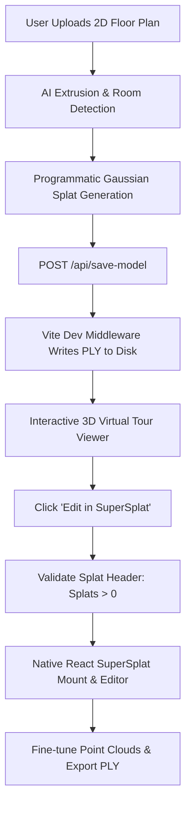

# 🏡 PropVision AI — 3D Real Estate & Gaussian Splatting Studio

> Transform 2D blueprints and floor plans into interactive, high-fidelity 3D Gaussian Splat environments and real-time virtual walkthroughs.

---

## 🌟 Highlights & Features

- **📐 2D Floor Plan to 3D Extrusion**:
  - Upload architectural floor plans, blueprints, or CAD sketches.
  - Automated room segmentation, wall extrusion, ceiling, and boundary layout generation.

- **🔮 Programmatic 3D Gaussian Splatting**:
  - Direct conversion of floor plan coordinates into standardized Gaussian Splat `.ply` files.
  - Encodes coordinates, spherical harmonics (SH) diffuse color channels, opacity, rotation quaternions, and anisotropic scales.

- **🎨 Native SuperSplat 3D Editor**:
  - Deeply integrated, same-origin **PlayCanvas** & **PCUI** Gaussian Splat editor running directly in React.
  - Edit point clouds, clip bounds, adjust spherical harmonics, and save modifications back to disk via `/api/save-model`.

- **🤖 Tencent Hunyuan3D-2.1 AI Integration**:
  - FastAPI-powered backend microservice interfacing with Tencent Hunyuan3D for generative text/image-to-3D mesh generation.

- **🌐 Interactive 3D Virtual Tours**:
  - Powered by **Three.js** and **React Three Fiber (@react-three/drei)**.
  - Orbit controls, first-person camera mode, room bookmarks, and responsive rendering.

- **📊 Property & Agent Management**:
  - Dynamic dashboard for property listings, status tracking, floor plan uploads, and interactive 3D demos.
  - Multi-language localization with **i18next** (English, Spanish, French, German, etc.).

---

## 🏗️ Architecture & Pipeline



---

## 🛠️ Technology Stack

| Layer | Technologies |
|---|---|
| **Frontend Framework** | [React 19](https://react.dev/), [TypeScript](https://www.typescriptlang.org/), [Vite](https://vitejs.dev/) |
| **3D Rendering & Splats** | [PlayCanvas](https://playcanvas.com/), [@playcanvas/pcui](https://github.com/playcanvas/pcui), [@playcanvas/splat-transform](https://github.com/playcanvas/splat-transform), [Three.js](https://threejs.org/), [@react-three/fiber](https://r3f.docs.pmnd.rs/), [@react-three/drei](https://github.com/pmndrs/drei) |
| **Animations & UI** | [Framer Motion](https://www.framer.com/motion/), SCSS / CSS Modules |
| **Internationalization** | [i18next](https://www.i18next.com/), `i18next-browser-languagedetector` |
| **Backend & AI Service** | [Python 3.10+](https://python.org/), [FastAPI](https://fastapi.tiangolo.com/), [Uvicorn](https://www.uvicorn.org/), Tencent Hunyuan3D-2.1 |

---

## 🚀 Quick Start Guide

### Prerequisites
- **Node.js**: v18.0.0 or higher (v20+ recommended)
- **npm** or **yarn**
- **Python**: 3.10+ (optional, only required if running the Hunyuan3D backend service)

---

### 1. Frontend Setup & Launch

1. **Install dependencies**:
   ```bash
   npm install
   ```

2. **Start the development server**:
   ```bash
   npm run dev
   ```

3. Open your browser and navigate to:
   ```
   http://localhost:5173
   ```
   *(Or the port specified in terminal output if 5173 is occupied, e.g., `http://localhost:5174`)*

---

### 2. Backend Setup (Optional for Generative AI)

1. **Navigate to the backend directory**:
   ```bash
   cd backend
   ```

2. **Create a virtual environment & install requirements**:
   ```bash
   python -m venv venv
   source venv/bin/activate  # On Windows: .\venv\Scripts\activate
   pip install fastapi uvicorn
   ```

3. **Run the FastAPI server**:
   ```bash
   python main.py
   ```
   The backend API will run on `http://localhost:8000` with interactive docs at `http://localhost:8000/docs`.

---

## 📜 Available Scripts

In the project root, you can run:

- `npm run dev`: Starts the Vite development server with hot module replacement (HMR).
- `npm run build`: Compiles TypeScript and builds production bundles into `dist/`.
- `npm run preview`: Previews the local production build.
- `npm run lint`: Runs ESLint across the codebase.

---

## 📁 Project Directory Structure

```text
Estate/
├── backend/                  # FastAPI backend service & Hunyuan3D model inference
│   ├── main.py               # FastAPI entry point & CORS configuration
│   ├── routes/               # API endpoints (/api/generate-3d)
│   └── services/             # 3D inference & model loading pipelines
├── public/                   # Static assets, icons, and generated .ply models
│   └── models/               # Saved Gaussian Splat PLY files
├── src/
│   ├── assets/               # Branding images, blueprints, and SVG icons
│   ├── components/           # Reusable UI components, header, 3D tour viewer
│   ├── context/              # Global application state (AppContext)
│   ├── supersplat/           # Bundled PlayCanvas Gaussian Splat editor engine
│   ├── styles/               # Global SCSS and themed stylesheets
│   ├── utils/                # Splat PLY generator, math, and parser utilities
│   ├── views/
│   │   ├── AppDashboard/     # Property listing & analytics management
│   │   ├── LandingPage/      # Hero landing page & showcase
│   │   ├── PropertyLanding/  # Interactive property showcase view
│   │   └── ThreeDEditor/     # Full-screen 3D SuperSplat editor workspace
│   ├── App.tsx               # Main routing & application component
│   └── main.tsx              # React DOM entry point
├── vite.config.ts            # Vite config with save-model middleware & proxy
└── package.json              # Project dependencies and npm scripts
```

---

## 📄 License

This project is licensed under the [MIT License](LICENSE).
